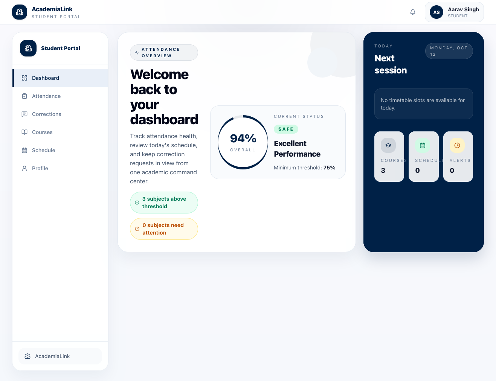

"# Classroom Attendance Management System

<p align="center">
  
  
  
  
  
  
  
  
</p>

<h1 align="center">Classroom Attendance Management System</h1>

<h3 align="center">Full-stack attendance platform with RBAC, live timetable validation, and immutable correction audit history</h3>

## Overview

The Classroom Attendance Management System is a comprehensive educational platform designed to streamline attendance tracking for educational institutions. It provides a robust, scalable solution for managing student attendance across multiple departments and academic programs.

### Core Capabilities

- **Role-Based Access Control (RBAC)**: Efficient three-tier permission system for Admin, Faculty, and Student roles with secure JWT authentication.
- **Real-time Scheduling & Validation**: Automated conflict detection for rooms, faculty, and sections utilizing intelligent time-interval validation.
- **Immutable Audit Trails**: Append-only correction history ensures data integrity and preserves the complete decision-making timeline.
- **Performance Optimized Architecture**: Precomputed attendance summaries and efficient delta-based updates provide rapid reporting and scalable performance.

## Technical Architecture

### Backend Stack
- **Runtime**: Node.js 20+ with Express 5.0
- **Database**: MySQL 8.0 with Prisma ORM 6.0
- **Security**: JWT authentication, robust middleware validation
- **Data Layer**: Atomic operations with Prisma migrations

### Frontend Stack
- **Framework**: React 19 with Vite 5.3 build tool
- **Styling**: Tailwind CSS 3.4 for modular, responsive design
- **State Management**: Scalable component architecture with custom hooks
- **Routing**: Secure role-based navigation guards

## Key Features

### Administrative Suite
Comprehensive dashboards for managing department structures, faculty/student accounts, room inventory, timetable generation, and high-level attendance reports.

### Faculty Workflow
Streamlined interface for recording attendance, processing student correction requests, and managing escalations directly within the application.

### Student Portal
Intuitive dashboard for monitoring attendance status, submitting correction requests, and receiving real-time notifications.

## Live Demo

Deployed on Render (single service, Express serves the API and the Vite SPA from one origin):

**https://academia-link.onrender.com**

> Note: the free plan sleeps when idle, so the first request after inactivity can take ~30 seconds to respond.

## Screenshots

[](docs/SHOWCASE.md)

**[View the full walkthrough (19 screenshots) →](docs/SHOWCASE.md)** — student, faculty, and administrator portals.

## Project Structure

```text
Classroom-Attendance-Management-System/
├── Backend/          # Node.js/Express API & Prisma ORM
├── Frontend/         # React/Vite SPA & Tailwind CSS
```

## Getting Started

### Prerequisites
- Node.js 20+
- MySQL 8+
- npm (or compatible package manager)

### Installation

```bash
# Backend Setup
cd Backend
npm install
npx prisma generate
npx prisma migrate deploy
npm start

# Frontend Setup
cd Frontend
npm install
npm run build
```

## Technical Highlights

This codebase showcases best practices in:
- **Full-stack Integration**: Seamless communication between React frontend and Node.js backend.
- **Database Engineering**: Utilizing ORMs and migrations, designing for auditability, and optimizing aggregate performance.
- **Security**: Implementing robust RBAC and token-based authentication.
- **Maintainability**: Clear separation of concerns, modular component design, and structured backend services.


